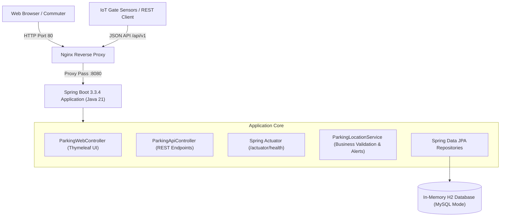

# DevOps-Enabled Public Parking Availability Dashboard (ParkWatch)


**Academic Project by:** Sajiya Shaikh  
**Roll Number:** 24102A2005  
**Course:** DevOps & Cloud Engineering  
**Academic Year:** 2026  

---

## 📌 Executive Overview

The **DevOps-Enabled Public Parking Availability Dashboard** (ParkWatch) is an enterprise-grade smart-city solution designed to eliminate downtown cruising traffic by streaming real-time parking capacity, occupancy rates, and saturation alerts to drivers and municipal operators.

The project demonstrates an end-to-end DevOps lifecycle across **15 sequential academic tasks**, unifying version control, automated backend testing (JUnit 5 & MockMvc), browser automation (Selenium WebDriver), containerization (Docker multi-stage), continuous integration & delivery (Jenkinsfile), and infrastructure automation (Ansible).

---

## 🏗️ System Architecture



---

## 🚀 Quick Start Guide

### 1. Prerequisites
- **JDK:** Java 21 LTS or newer (`java -version`)
- **Maven:** Apache Maven 3.8+ or 3.9+ (`mvn -version`)
- **Browser:** Microsoft Edge, Google Chrome, or Mozilla Firefox

### 2. Build and Test
Run the full test suite and package the runnable JAR:
```bash
# Execute 33 unit and service integration tests
mvn clean test

# Package the application
mvn package
```

### 3. Start the Application
```bash
java -jar target/public-parking-dashboard-1.0.0.jar
```

The application boots in approximately 5 seconds and is immediately accessible at:
- 🌐 **Web Dashboard:** [http://localhost:8080/](http://localhost:8080/)
- 📡 **REST API:** [http://localhost:8080/api/v1/dashboard/summary](http://localhost:8080/api/v1/dashboard/summary)
- ❤️ **Actuator Health:** [http://localhost:8080/actuator/health](http://localhost:8080/actuator/health)
- 🗄️ **H2 Database Console:** [http://localhost:8080/h2-console](http://localhost:8080/h2-console) (JDBC URL: `jdbc:h2:mem:parkingdb`, User: `sa`)

---

## 📋 15 Academic Tasks Progress Summary

All 15 tasks have been designed, coded, and validated:

| Task # | Academic Milestone | Key Deliverables | Status |
| :--- | :--- | :--- | :--- |
| **01** | Project Initialization & Architecture | Requirements, architecture diagrams, Maven setup | **VERIFIED** |
| **02** | Git Repository & Branching Strategy | Git repository, commit history, .gitignore, branching plan | **VERIFIED** |
| **03** | Domain Modeling & Database Schema | Entities (ParkingLocation, ParkingEvent), JPA repositories | **VERIFIED** |
| **04** | Core Service Layer & Business Validation | ParkingLocationService, business validation, alert triggers | **VERIFIED** |
| **05** | RESTful API Implementation | ParkingApiController, DTOs, CRUD & event endpoints | **VERIFIED** |
| **06** | Responsive Web UI (Thymeleaf + CSS) | Dashboard, detail views, event forms, alerts page | **VERIFIED** |
| **07** | Unit & Service Integration Testing | JUnit 5 tests, Mockito, MockMvc controller tests (33/33 pass) | **VERIFIED** |
| **08** | Browser Automation (Selenium E2E) | 7 Selenium tests, headless execution, screenshot capture | **VERIFIED** |
| **09** | Application Health & Actuator Telemetry | Spring Boot Actuator, custom health checks, ping endpoint | **VERIFIED** |
| **10** | Containerization (Docker) | Multi-stage Dockerfile, .dockerignore, container validation | **IMPLEMENTED** |
| **11** | Reverse Proxy & Network Architecture | Nginx configuration, port mapping, proxy headers | **IMPLEMENTED** |
| **12** | Continuous Integration (Jenkins Pipeline) | Declarative Jenkinsfile, quality gates, test archival | **IMPLEMENTED** |
| **13** | Infrastructure as Code (Ansible) | Playbook, group_vars, inventory example, idempotency | **IMPLEMENTED** |
| **14** | Automated Rollback & Disaster Recovery | PowerShell & Bash rollback scripts, failure simulation | **IMPLEMENTED** |
| **15** | Comprehensive Documentation & Viva Prep | PROGRESS.md, README.md, diagrams, viva Q&A | **VERIFIED** |

*For complete task details and evidence, refer to [`docs/PROGRESS.md`](docs/PROGRESS.md).*

---

## 🧪 Testing & Quality Gates

### Automated Backend Tests (JUnit 5 + MockMvc)
```bash
mvn clean test
```
- **33/33 Tests Passed:**
  - `ParkingLocationServiceTest`: 21 tests (CRUD, capacity constraints, math, alerts)
  - `ParkingApiControllerTest`: 11 tests (REST endpoints, JSON structure, error handling)
  - `ParkingDashboardApplicationTests`: 1 test (Spring Boot context load)

### Browser Automation (Selenium WebDriver)
```bash
mvn test "-Dtest=ParkingDashboardSeleniumTest" "-Dapp.base.url=http://localhost:8080" "-Dselenium.headless=true"
```
- Covers 7 complete end-to-end user journeys including search, filters, updates, and boundary validations.
- Failure screenshots automatically saved to `target/selenium-screenshots/`.

---

## 🐳 Docker Containerization

Multi-stage build ensures minimal image size and enhanced security:
```bash
# Build image
docker build -t parkwatch:latest .

# Run container
docker run -d -p 8080:8080 --name parkwatch parkwatch:latest
```

---

## ⚙️ CI/CD Pipeline & Ansible

- **Jenkins Pipeline (`Jenkinsfile`):** 9 declarative stages covering Checkout, Compile, Unit Tests, JAR Packaging, Selenium E2E, Quality Gates, Docker Build, Staging Deploy, and Health Verification.
- **Ansible Automation (`ansible/playbook.yml`):** Idempotent server provisioning, Docker host setup, non-root user management, and automated container deployment.

---

## 📚 Project Documentation Directory

- 📖 [SRS & Agile Backlog](docs/requirements/specifications.md)
- 📊 [Architecture & Diagrams](docs/diagrams/architecture.md)
- 📡 [REST API Specification](docs/api_documentation.md)
- 💻 [Local Setup Instructions](docs/local_setup.md)
- 🌿 [Git Workflow & Branching Strategy](docs/git_workflow.md)
- 🔄 [Jenkins CI/CD Pipeline Guide](docs/jenkins_pipeline.md)
- 🤖 [Selenium E2E Test Plan](docs/selenium_test_plan.md)
- 🐳 [Docker Containerization Guide](docs/docker_documentation.md)
- 🛠️ [Ansible IaC Guide](docs/ansible_documentation.md)
- 🔧 [Troubleshooting Guide](docs/troubleshooting_guide.md)
- 🎓 [Final Report & Academic Viva Q&A](docs/final_report_and_viva.md)
- 📈 [15-Task Progress Matrix](docs/PROGRESS.md)
