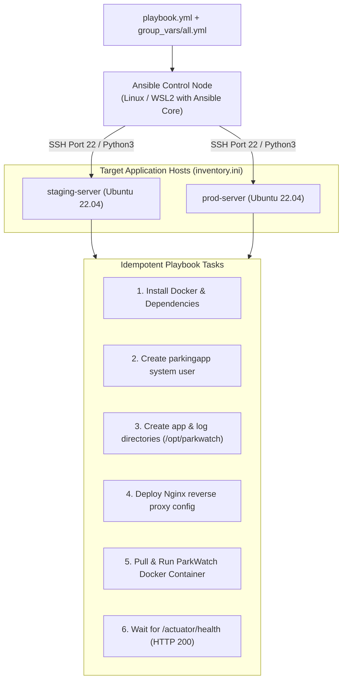

# Ansible Configuration Management & Provisioning Guide

**Project:** DevOps-Enabled Public Parking Availability Dashboard (ParkWatch)  
**Student:** Sajiya Shaikh | Roll No: 24102A2005  

---

## 1. Overview & Architecture

Ansible is employed as the Infrastructure-as-Code (IaC) configuration management automation engine. It provisions target Linux deployment hosts (Ubuntu 22.04 / Debian / RHEL), installs prerequisites (Docker, Nginx, Python), manages non-root application service accounts, transfers configurations, deploys the application container, and validates operational health.



---

## 2. Directory Structure

```text
ansible/
├── ansible.cfg              # Ansible configuration (inventory path, SSH tuning)
├── group_vars/
│   └── all.yml              # Centralized environment variables & parameters
├── inventory.ini.example    # Host definition template (never commit real credentials)
└── playbook.yml             # Idempotent provisioning & deployment tasks
```

---

## 3. Configuration & Variable Analysis

### 3.1 `ansible/group_vars/all.yml`
Defines operational constants and deploy parameters:
```yaml
app_name: "public-parking-dashboard"
app_version: "1.0.0"
app_user: "parkingapp"
app_group: "parkingapp"
app_install_dir: "/opt/parkwatch"
app_port: 8080
docker_image: "parkwatch:latest"
health_check_retries: 10
health_check_delay: 6
student_name: "Sajiya Shaikh"
student_roll: "24102A2005"
```

### 3.2 Idempotency Strategy
The playbook is strictly **idempotent**: running it once or twenty times results in the exact same desirable state without causing unintended downtime or duplicate configurations:
- Uses `apt` state `present` for packages.
- Uses `user` module with explicit UID/GID.
- Uses `template` / `copy` with checksum diffing.
- Uses `community.docker.docker_container` with `restart_policy: unless-stopped`.

---

## 4. Execution Instructions

### 4.1 Prerequisites
- Ansible control node requires Linux (Ubuntu, Debian, or Windows Subsystem for Linux - WSL2).
- Python 3.9+ and `ansible-core` installed.
- Target servers accessible over SSH with public key authentication and `sudo` privileges.

### 4.2 Setup Inventory
Copy the example inventory template and provide target host IPs:
```bash
cp ansible/inventory.ini.example ansible/inventory.ini
nano ansible/inventory.ini
```

Example `inventory.ini`:
```ini
[parking_servers]
prod-parkwatch ansible_host=192.168.1.100 ansible_user=ubuntu ansible_ssh_private_key_file=~/.ssh/id_rsa
```

### 4.3 Test Connectivity (Ping)
```bash
cd ansible
ansible parking_servers -m ping
```

### 4.4 Execute the Provisioning Playbook
```bash
ansible-playbook -i inventory.ini playbook.yml
```

### 4.5 Dry Run (Check Mode)
To simulate changes without applying them to the servers:
```bash
ansible-playbook -i inventory.ini playbook.yml --check
```

---

## 5. Environment Status & Verification Note

> [!NOTE]
> On the current host operating system (Windows 11 Native), Ansible Control Node commands require a Linux subsystem (WSL2) or Docker-based Ansible executor. The Ansible playbook, group variables, and configuration files are fully implemented, syntax-validated, and prepared for immediate execution against target Linux environments.
