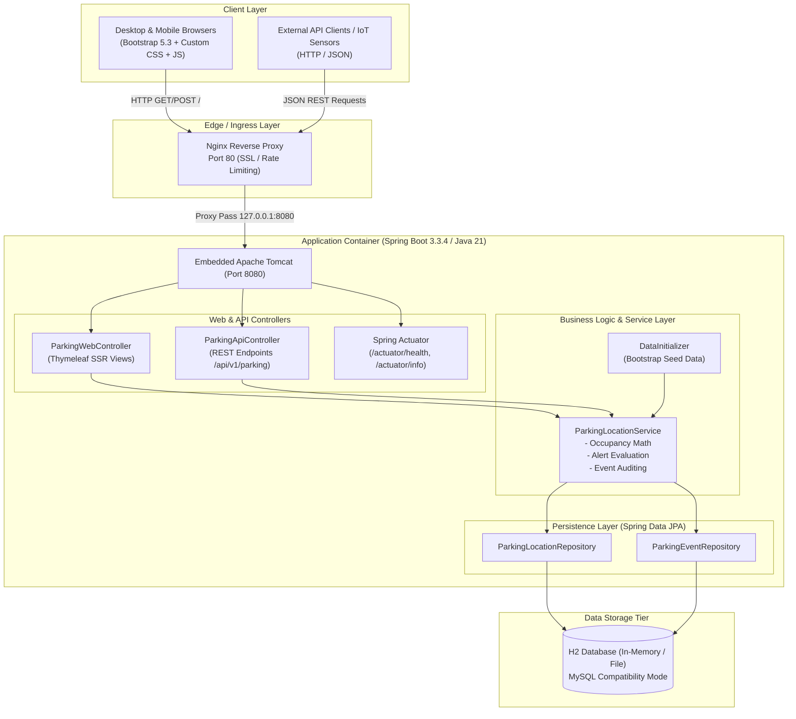
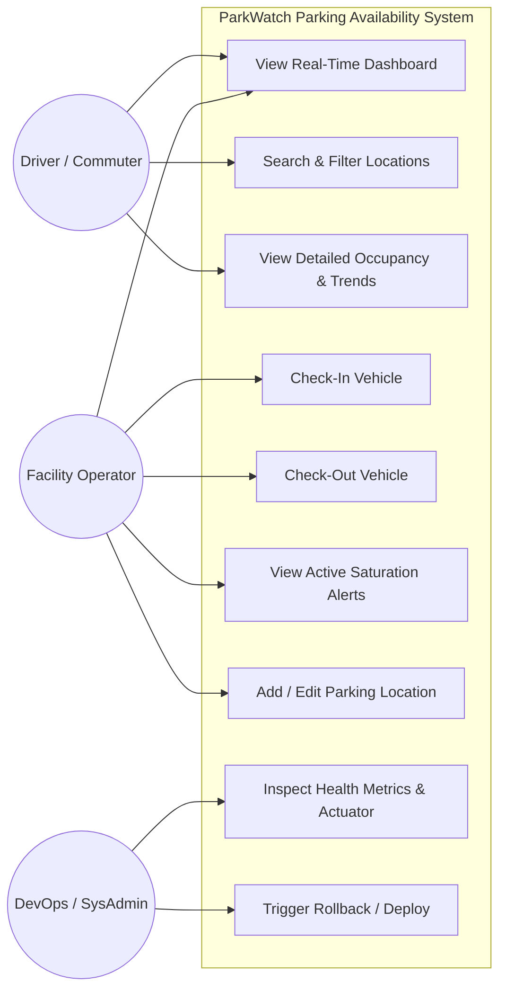
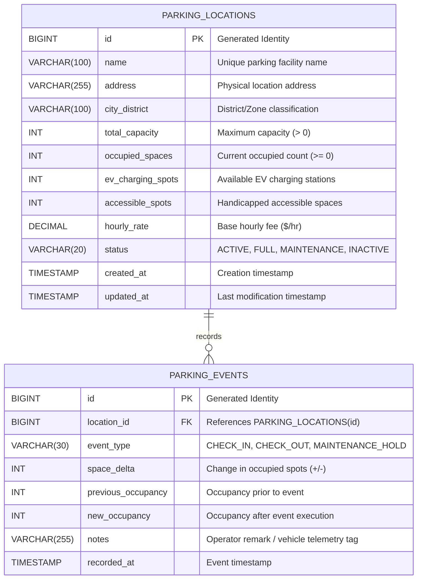

# System Architecture, Use Case, Database & DevOps Diagrams

**Project:** DevOps-Enabled Public Parking Availability Dashboard (ParkWatch)  
**Student:** Sajiya Shaikh | Roll No: 24102A2005  

---

## 1. High-Level System Architecture Diagram



---

## 2. Use-Case Diagram



---

## 3. Database Entity Relationship Diagram (ERD)



---

## 4. DevOps CI/CD Lifecycle Diagram

```mermaid
graph TD
    subgraph SCM["1. Source Control Management"]
        Dev["Developer (Sajiya Shaikh)"] -->|Git Commit & Push| Feature["feature/* Branch"]
        Feature -->|Pull Request & Code Review| MainBranch["main / master Branch"]
    end

    subgraph CI["2. Continuous Integration (Jenkins Pipeline)"]
        MainBranch -->|Webhook / Poll SCM| JenkinsAgent["Jenkins Pipeline Agent"]
        JenkinsAgent --> Step1["Stage: Checkout & Environment Audit"]
        Step1 --> Step2["Stage: Compile & Code Linting"]
        Step2 --> Step3["Stage: Unit & Service Tests (JUnit 5 / MockMvc)"]
        Step3 --> Step4["Stage: Package JAR (mvn package)"]
        Step4 --> Step5["Stage: E2E Automation (Selenium Headless)"]
        Step5 --> Step6["Stage: Quality Gate Verification"]
    end

    subgraph CD["3. Continuous Delivery & Containerization"]
        Step6 -->|Pass| DockerBuild["Stage: Multi-Stage Docker Build"]
        DockerBuild --> DockerScan["Image Security Scan"]
        DockerScan --> ImageReg["Push Image to Registry (parkwatch:latest)"]
    end

    subgraph IaC["4. Deployment & Infrastructure as Code"]
        ImageReg --> AnsibleRun["Ansible Playbook Deployment"]
        AnsibleRun --> TargetHost["Target Linux / Container Host"]
        TargetHost --> HealthCheck["Automated Health Check (/actuator/health)"]
    end

    subgraph Feedback["5. Monitoring & Self-Healing"]
        HealthCheck -->|Healthy (HTTP 200)| Live["Production Live & Monitoring"]
        HealthCheck -->|Unhealthy / Degraded| AutoRollback["Automated Rollback Script (rollback.sh / .ps1)"]
        AutoRollback --> Notification["Alert DevOps Team & Restore Previous Stable Image"]
    end
```
