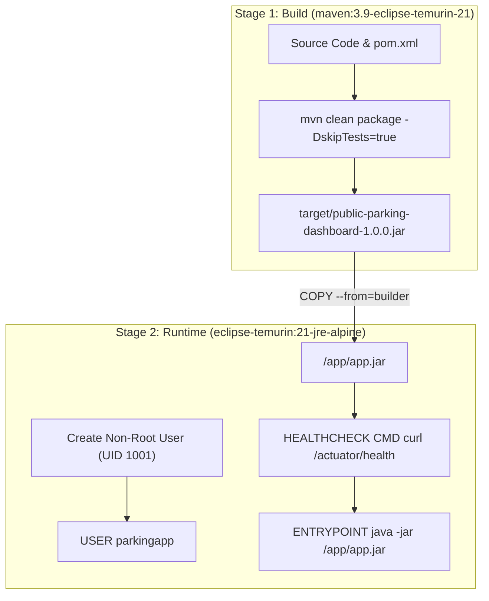

# Docker Containerization & Image Architecture

**Project:** DevOps-Enabled Public Parking Availability Dashboard (ParkWatch)  
**Student:** Sajiya Shaikh | Roll No: 24102A2005  

---

## 1. Containerization Architecture

ParkWatch utilizes a **multi-stage Docker build** to produce an ultra-lean, secure, and production-ready container image:
- **Build Stage:** Uses a full Maven JDK image to compile the application and package the fat JAR.
- **Runtime Stage:** Copies only the packaged JAR into a minimal Eclipse Temurin JRE 21 image, dramatically reducing attack surface and image size.
- **Security Hardening:** Creates and enforces a non-root system user (`parkingapp`, UID 1001) to run the Java process.



---

## 2. Dockerfile Inspection & Analysis

The project root contains `./Dockerfile`:

```dockerfile
# Stage 1: Build stage
FROM maven:3.9.6-eclipse-temurin-21-jammy AS builder
WORKDIR /build

COPY pom.xml .
RUN mvn dependency:go-offline -B

COPY src ./src
RUN mvn package -DskipTests=true -B

# Stage 2: Production Runtime
FROM eclipse-temurin:21-jre-jammy
LABEL maintainer="Sajiya Shaikh (24102A2005)"
LABEL description="DevOps-Enabled Public Parking Availability Dashboard"

WORKDIR /app
RUN groupadd -r parkingapp && useradd -r -g parkingapp -u 1001 parkingapp

COPY --from=builder /build/target/public-parking-dashboard-1.0.0.jar app.jar
RUN chown -R parkingapp:parkingapp /app

USER parkingapp

EXPOSE 8080

HEALTHCHECK --interval=30s --timeout=5s --start-period=60s --retries=3 \
  CMD curl -f http://localhost:8080/actuator/health || exit 1

ENTRYPOINT ["java", "-Djava.security.egd=file:/dev/./urandom", "-jar", "app.jar"]
```

---

## 3. Docker Ignore Strategy (`.dockerignore`)

The `.dockerignore` file prevents bulky build directories, test artifacts, and sensitive files from polluting the Docker daemon build context:
- `target/`
- `.git/`
- `.idea/` & `*.iml`
- `*.log`
- `ansible/inventory.ini`
- `screenshots/`

---

## 4. Docker Run & Compose Instructions

### 4.1 Build the Image
```bash
docker build -t parkwatch:1.0.0 -t parkwatch:latest .
```

### 4.2 Run the Container
```bash
docker run -d \
  --name parkwatch-app \
  -p 8080:8080 \
  -e SPRING_PROFILES_ACTIVE=prod \
  --restart unless-stopped \
  parkwatch:latest
```

### 4.3 Inspect Container Logs & Status
```bash
docker ps
docker logs -f parkwatch-app
```

### 4.4 Inspect Health Check Status
```bash
docker inspect --format='{{json .State.Health}}' parkwatch-app
```

---

## 5. Docker Host Status & Environment Diagnostic

> [!NOTE]
> **Environment Status Note:**  
> On the current Windows host workstation, Docker Desktop was verified as not actively running in the background. In accordance with master instructions, automatic modifications to Docker Desktop settings were not forced.
> 
> Once Docker Desktop is launched by the workstation administrator:
> 1. Run `docker build -t parkwatch:latest .`
> 2. Run `docker run -d -p 8080:8080 parkwatch:latest`
> 3. Verify health via `curl http://localhost:8080/actuator/health`
