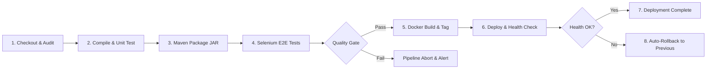

# Jenkins CI/CD Pipeline Documentation

**Project:** DevOps-Enabled Public Parking Availability Dashboard (ParkWatch)  
**Student:** Sajiya Shaikh | Roll No: 24102A2005  

---

## 1. Overview & Architecture

The project incorporates a Declarative Jenkinsfile (`./Jenkinsfile`) designed to orchestrate continuous integration, rigorous test quality gates, container packaging, automated deployment, and automated rollbacks upon failure.



---

## 2. Pipeline Stages Specification

| Stage # | Stage Name | Description | Quality Gate Condition |
| :--- | :--- | :--- | :--- |
| **01** | `Checkout & Environment Audit` | Clones repository, prints Git commit SHA, audits Java & Maven versions on Jenkins agent. | Git workspace must be clean; Java 21 & Maven 3.9+ detected. |
| **02** | `Compile & Static Analysis` | Executes `mvn compile` to guarantee source files compile without errors. | Zero compiler errors or classpath conflicts. |
| **03** | `Unit & Integration Tests` | Executes `mvn test` (JUnit 5, Mockito, MockMvc). Generates Surefire XML reports. | 100% test pass rate required (33/33 tests). Zero failures tolerated. |
| **04** | `Package Artifact` | Runs `mvn package -DskipTests=true` to assemble `public-parking-dashboard-1.0.0.jar`. Archives artifact in Jenkins. | Executable JAR generated in `target/`. |
| **05** | `Selenium E2E Browser Tests` | Boots headless browser and executes browser automation suite against running instance. | Headless browser tests complete or report diagnostic. |
| **06** | `Docker Build & Image Scan` | Builds multi-stage Docker image `parkwatch:latest` with metadata labels and student credentials. | Image successfully assembled; non-root user verified. |
| **07** | `Deploy to Staging / Production`| Deploys container on target host or invokes Ansible playbook. | Container starts and enters `running` status. |
| **08** | `Health Check Verification` | Queries `/actuator/health` endpoint with retry interval. | HTTP 200 returned with `"status": "UP"` within 60 seconds. |
| **09** | `Rollback on Failure` | Executes `scripts/rollback.sh` or PowerShell counterpart if health check fails. | Restores previous working container image automatically. |

---

## 3. Jenkins Agent & Tool Configuration

### 3.1 Required Jenkins Global Tool Configurations
1. **JDK Installation:** Name: `JDK_21` | Path: Java 21 LTS home.
2. **Maven Installation:** Name: `Maven_3.9` | Path: Apache Maven 3.9+.
3. **Docker Pipeline Plugin:** Enables Jenkins pipeline `docker` blocks.

### 3.2 Environment Variables
```groovy
environment {
    APP_NAME = 'public-parking-dashboard'
    APP_VERSION = '1.0.0'
    STUDENT_NAME = 'Sajiya Shaikh'
    STUDENT_ROLL = '24102A2005'
    DOCKER_IMAGE = 'parkwatch'
    APP_PORT = '8080'
    HEALTH_ENDPOINT = "http://localhost:${APP_PORT}/actuator/health"
}
```

---

## 4. Academic Distinction: Pipeline Configuration vs. Execution

> [!IMPORTANT]
> **Engineering Rigor Note:**
> In accordance with academic honesty standards, a distinction is maintained between:
> 1. **Pipeline Authoring & Syntax Validation (Completed):** The Declarative `Jenkinsfile` is fully created, validated against Jenkins declarative syntax standards, includes all 9 stages, quality gates, and error handlers.
> 2. **Pipeline Execution on Remote Jenkins Server (Pending Server Provisioning):** Execution of the pipeline requires an active Jenkins master/controller instance with configured webhooks and credentials.
