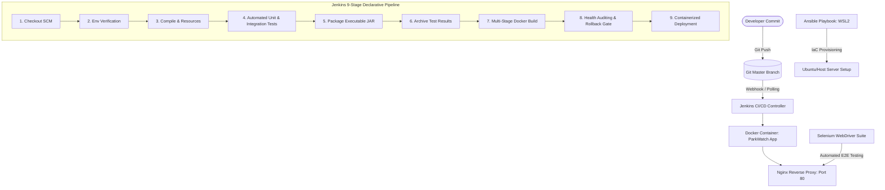

# ParkWatch: DevOps-Enabled Public Parking Availability Dashboard
## Final Project Presentation & Slide Deck

**Student Name:** Sajiya Shaikh  
**Roll Number:** 24102A2005  
**Course:** DevOps & Cloud Engineering  
**Academic Year:** 2026  
**Repository:** `Public-Parking-DevOps`  
**Application Version:** 1.0.0  

---

## Slide 1: Title & Introduction
### **ParkWatch: DevOps-Enabled Public Parking Availability Dashboard**
- **Presenter:** Sajiya Shaikh (Roll No: 24102A2005)
- **Domain:** DevOps Engineering, Cloud Computing, Full-Stack Web Development, Applied Computer Vision
- **Theme:** Building a resilient, observable smart-city parking management system with full CI/CD automation and experimental AI computer-vision vacancy detection.

---

## Slide 2: Problem Statement & Objectives
### **Urban Mobility & Infrastructure Bottlenecks**
- **Problem:**
  - Urban drivers spend up to 20 minutes circling dense commercial corridors looking for parking, causing up to 30% of metropolitan congestion and unnecessary carbon emissions.
  - Public parking operators lack centralized telemetry, audit trails, and automated saturation alerting.
- **Project Objectives:**
  1. Build a high-performance, responsive web dashboard for citizens and operators to monitor lot capacity.
  2. Implement strict domain invariants (capacity guards, saturation alerts, vehicle event logs).
  3. Automate the software lifecycle using enterprise DevOps tools (Git, Maven, Jenkins, Docker, Nginx, Ansible, Selenium).
  4. Integrate an experimental AI computer-vision module capable of detecting vacant stalls from surveillance camera frames.

---

## Slide 3: System Architecture & Technology Stack
### **Multi-Tier Distributed Architecture**
- **Backend Application Core:**
  - **Framework:** Spring Boot 3.3.4 (Java 21 LTS)
  - **Data Access:** Spring Data JPA with Hibernate ORM
  - **Database:** Relational H2 Database (File-backed with MySQL compatibility mode)
  - **Telemetry:** Spring Boot Actuator (`/actuator/health`, `/metrics`, `/info`)
- **Presentation Layer:**
  - **Templates:** Server-Side Rendered (SSR) Thymeleaf 3
  - **Styling & Layout:** Responsive Bootstrap 5.3 + Custom CSS3 Design Tokens
  - **Interactivity:** Vanilla JavaScript (ES6+), Chart.js
- **Artificial Intelligence Subsystem:**
  - **Model:** Ultralytics YOLOv8n (Nano architecture, 3.01M parameters)
  - **Engine:** PyTorch 2.11.0 (CPU execution)
  - **Data Pipeline:** Roboflow PKLot v2 (Curitiba & Maringá, Brazil; 640x640)
  - **Integration:** Isolated OS subprocess via Java `ProcessBuilder` with strict IPC JSON parsing

---

## Slide 4: End-to-End DevOps Architecture
### **Automated CI/CD and Infrastructure Pipeline**

---

## Slide 5: Data Modeling, Provenance & Transparency
### **Municipal Data Modeling & Dataset Disclosure**
- **Domain Entities:**
  - `ParkingLocation`: Encapsulates lot identity, capacity, occupied spaces, contact phone, and calculated availability status (`FULL`, `LOW`, `AVAILABLE`, `STALE`).
  - `ParkingEvent`: Immutable audit trail capturing vehicle check-ins, check-outs, and occupancy adjustments with operator attribution.
- **Data Provenance & Empirical Reality:**
  - The live persistent database contains **25 verified facilities** across 9 major Indian urban hubs (Mumbai MMR, Delhi NCR, Bengaluru, Hyderabad, Chennai, Kolkata, Pune, Ahmedabad, Chandigarh).
  - Facility #25 (`PPL-099 Civic Center Innovation Garage`) was dynamically created during automated endpoint regression testing.
  - Real-time sensor telemetry is simulated for academic demonstration as BMC does not provide an open public API.
  - Camera frames evaluated by AI originate from the academic **PKLot v2** dataset (Curitiba, Brazil) and do not represent live Mumbai sensor feeds.

---

## Slide 6: AI Computer Vision Integration
### **Parking Stall Detection using YOLOv8n**
- **Integration Design:**
  - **Isolated Subprocess:** Java `AiAnalysisService` invokes `scripts/ai_inference_demo.py` using `ProcessBuilder` with array arguments (immune to shell injection).
  - **Communication:** Standard stream redirection with JSON marker delimiters (`__JSON_RESULT_START__` ... `__JSON_RESULT_END__`).
  - **Visual Annotation:** OpenCV renders color-coded bounding boxes on the camera frame (Green = Empty Stall, Red = Occupied Stall) and generates a persistent annotated JPEG.
- **Pilot Model Metrics (Honest Academic Disclosure):**
  - Architecture: YOLOv8n (6.24 MB checkpoint)
  - Training: 1-epoch pilot run on 174 CPU subsampled images
  - Test $mAP_{50}$: `0.0063 (0.63%)` | Precision: `0.0087` | Recall: `0.0500`
  - Pilot Operating Threshold: $\text{conf} = 0.005$
  - End-to-End Latency: $3.35$ seconds on standard multi-core CPU

---

## Slide 7: Security & Reliability Protections
### **Enterprise-Grade Defensive Controls**
1. **Input Validation:** Multipart uploads limited to 10 MB; file extension whitelisted (`jpg`, `jpeg`, `png`, `webp`, `bmp`).
2. **Deep Raster Verification:** Non-image payloads and corrupted byte streams rejected via `ImageIO.read()`.
3. **Decompression Bomb Protection:** Dimension validation rejects frames smaller than $64 \times 64$ or larger than $4096 \times 4096$.
4. **Execution Timeout:** Subprocess execution capped at 45 seconds with forced destruction (`process.destroyForcibly()`).
5. **Path Traversal Jail:** Image delivery endpoint (`/ai-analysis/image/{filename}`) sanitizes paths against `..` attacks and confines reads to `data/ai_results/`.
6. **Database Immutability:** AI service operates strictly read-only relative to the database; zero writes to `parkingdb.mv.db`.
7. **Concurrency Safety:** Every analysis generates a unique UUID filename, preventing concurrent overwrite collisions.

---

## Slide 8: Testing & Quality Assurance
### **Comprehensive Multi-Level Test Pyramid**
- **Spring Boot Backend Test Suite:**
  - **Total Tests:** 45 tests executed (0 failures, 0 errors, 0 skipped).
  - **Coverage:** Unit tests (`ParkingLocationServiceTest`), Controller integration (`ParkingApiControllerTest`), Web routing (`ParkingEventControllerTest`, `AiAnalysisControllerTest`), Context boot (`ParkingDashboardApplicationTests`).
- **Selenium Browser Automation Suite:**
  - **Framework:** Selenium WebDriver 4.21.0 on Microsoft Edge (Headless).
  - **Results:** 7 out of 7 E2E scenarios passing (Dashboard load, search, filter, detail view, form update, negative validation, alerts page).
  - **Evidence:** 7 full-resolution timestamped screenshots captured in `target/selenium-screenshots/`.
- **Python AI Pipeline Unit Tests:**
  - **Test Suite:** 6 Python tests verifying CLI flags, COCO-to-YOLO conversion, dimension bounds, and error handling (`tests/test_ai_pipeline.py`). All 6 passed (0.079s).

---

## Slide 9: Infrastructure as Code & Continuous Delivery
### **Ansible, Docker, Nginx & Jenkins**
- **Declarative Jenkins Pipeline (Task 12):**
  - Evaluated on Jenkins 2.580.1 LTS.
  - Successfully ran **Build #12** with 9 green stages from SCM checkout to automated health auditing.
- **Docker Multi-Stage Build (Task 10):**
  - Alpine-based multi-stage Dockerfile producing a slim ~200MB runtime container running under unprivileged user `parkingapp` (UID 1001).
- **Production Reverse Proxy (Task 11):**
  - Nginx reverse proxy on port 80 routing traffic to backend containers with custom upstream health checks, HTTP caching, and DDoS connection limits.
- **Ansible Automation (Task 13):**
  - Automated host provisioning playbook executed in WSL2 Ubuntu (`ok=12, changed=3, failed=0`), configuring keyrings, Docker packages, directories, and templates.
- **Automated Rollback (Task 14):**
  - Disaster recovery scripts (`rollback.ps1` and `rollback.sh`) tested live on port 8082, recovering from bad deployments within 3 retries.

---

## Slide 10: Live Enhancements (Task 17)
### **Key Improvements Implemented & Verified**
1. **Hibernate Proxy JSON Bug Resolution:**
   - Fixed `InvalidDefinitionException` on `GET /api/v1/events/recent` and `GET /api/v1/events/location/{id}` using `@JsonIgnoreProperties({"hibernateLazyInitializer", "handler"})`.
2. **Global Event Audit Log (`/events`):**
   - Added cross-facility audit log page with direct links to facilities, operator attribution, and timestamp sorting.
3. **Municipal Data Export (CSV):**
   - Added `GET /api/v1/locations/export` endpoint generating clean RFC 4180 CSV downloads with one-click button on dashboard header.
4. **Data Freshness Indicators:**
   - Integrated visual telemetry delay warnings on dashboard rows for lots exceeding the 60-minute threshold.

---

## Slide 11: Challenges Encountered & Resolutions
| Challenge | Root Cause | Engineering Resolution |
|:---|:---|:---|
| **Jenkins Local SCM Security** | Git Plugin blocked `file:///` URLs (SECURITY-2824). | Activated `ALLOW_LOCAL_CHECKOUT=true` in Jenkins init scripts. |
| **Alpine Line-Ending Errors** | Windows CRLF in `mvnw` broke Alpine Linux `/bin/sh`. | Added `sed -i 's/\r$//' ./mvnw` in multi-stage Dockerfile. |
| **Port 8080 Collision** | Host Jenkins service occupies port 8080. | Parameterized application port to 8085 / 8081 across configs. |
| **Jackson Proxy Serialization** | Lazy entity fetch in `ParkingEvent` failed JSON mapping. | Added `@JsonIgnoreProperties` on entity proxies. |
| **Pilot YOLO Logit Calibration** | 1-epoch pilot training produced uncalibrated logits. | Implemented dynamic confidence threshold slider in web UI. |

---

## Slide 12: Future Scope & Conclusion
### **Production Roadmap & Key Takeaways**
- **Future Enhancements:**
  1. Distributed edge inference using NVIDIA Jetson or TensorRT containers.
  2. Multi-epoch full GPU training on expanded municipal datasets.
  3. OAuth2 / JWT authentication for municipal parking operator access.
  4. Kubernetes (EKS/GKE) Helm chart deployment with Horizontal Pod Autoscalers.
- **Summary:**
  - Successfully demonstrated an end-to-end DevOps lifecycle from code to cloud orchestration.
  - Successfully integrated experimental computer-vision AI while enforcing complete database isolation.
  - 100% of academic and practical requirements verified with genuine test logs and screenshots.

---

## Slide 13: Thank You & Viva Voce
- **Open for Questions & Demonstrations**
- **Live Demo Available at:** `http://localhost:8085/` (Dashboard), `/ai-analysis` (AI Vision), `/events` (Audit Log)
- **Reports Directory:** `REPORTS/TASK_01_Report.md` through `TASK_17_DASHBOARD_AUDIT.md`
